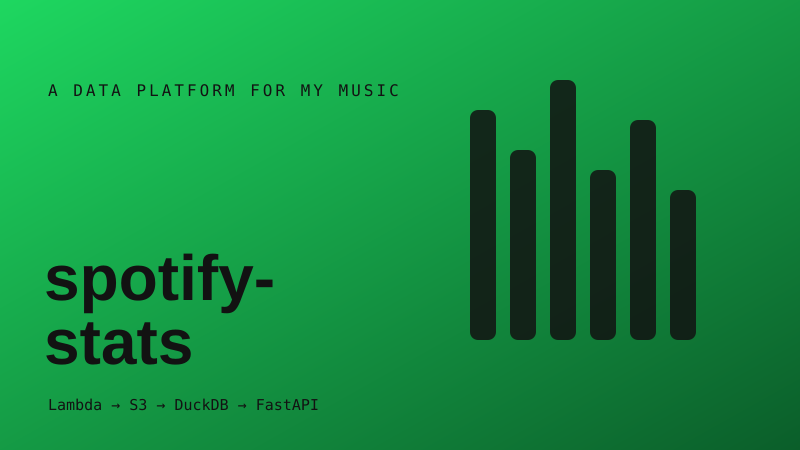
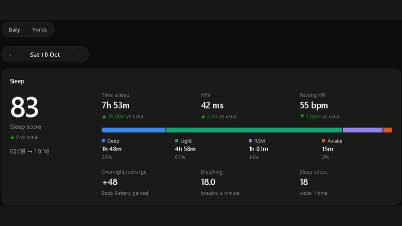
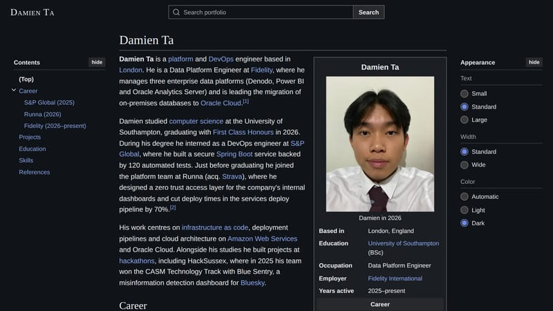
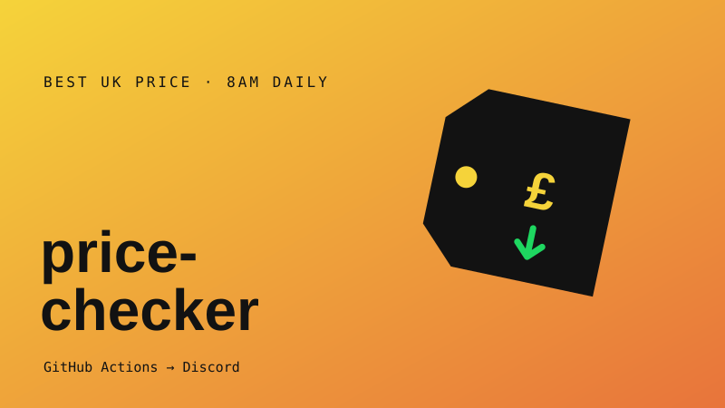
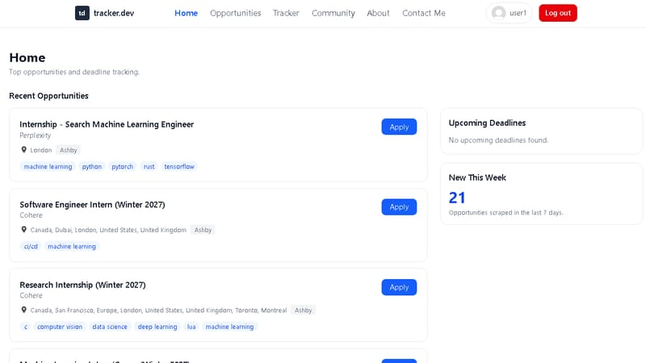
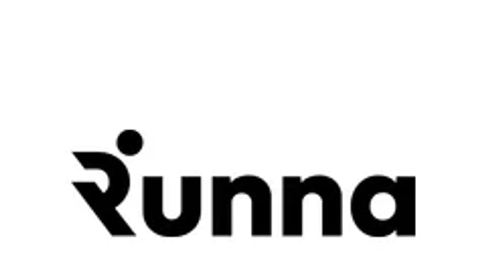

  

  
  
  

### 🎧 Liner notes

I like building things that help me. If I want to know how I slept, what I've had on repeat or whether something I want finally dropped in price, I'd rather build the tool than check five apps. Most of my side projects start that way, and they're where I try out tech I don't get to use at work.

Day to day I look after Denodo, Oracle Analytics and Power BI at Fidelity, and I'm moving on-prem databases into Oracle Cloud.

  

### 📜 Quest log

<table>
  <tr>
    <td width="50%" valign="top">
      
      <h3><a href="https://github.com/damienta/spotify-stats">Spotify Stats</a></h3>
      <code>▶ NOW PLAYING · IN PROGRESS</code>
      
A stats.fm-style listening tracker I'm growing into a small data platform. A Lambda polls Spotify every 20 minutes, DuckDB crunches the stats and FastAPI serves them. Airflow, dbt and an Iceberg lakehouse are next.

      Python · AWS Lambda · DynamoDB · DuckDB · Terraform
    </td>
    <td width="50%" valign="top">
      
      <h3><a href="https://github.com/damienta/garmin-health-monitor">Garmin Health Monitor</a></h3>
      <code>LIVE · RUNS EVERY MORNING</code>
      
My own sleep and recovery dashboard. Every morning it pulls last night from my watch, shows a green, amber or red recovery light and drops a summary in Discord. Runs on free plans.

      Python · React · Cloudflare Workers · D1 · GitHub Actions
    </td>
  </tr>
  <tr>
    <td width="50%" valign="top">
      
      <h3><a href="https://damienta.pages.dev/">Portfolio, the Wikipedia edition</a></h3>
      <code>LIVE</code>
      
My portfolio, written as a Wikipedia article about me. Infobox, contents sidebar, citations, page search, light and dark mode, even a "last edited" footer.

      React · TypeScript · Vite · Cloudflare Pages
    </td>
    <td width="50%" valign="top">
      
      <h3><a href="https://github.com/damienta/price-checker">Price Checker</a></h3>
      <code>LIVE · 8AM DAILY</code>
      
Tell it what I want and a price to beat. Every morning it checks UK shops, PriceSpy, PriceRunner and HotUKDeals, then posts the best deal to Discord. No server, no database.

      Python · GitHub Actions · Discord
    </td>
  </tr>
  <tr>
    <td width="50%" valign="top">
      
      <h3><a href="https://github.com/damienta/internship-tracker">Tracker.dev</a></h3>
      <code>COMPLETE · DISSERTATION</code>
      
A full-stack internship tracker with scrapers that pull in graduate and internship roles, plus application tracking and community threads.

      React · Flask · PostgreSQL · Pytest
    </td>
    <td width="50%" valign="top">
       
      <h3>Boss fights (hackathons)</h3>
      <code>2 CLEARED</code>
      
<b>Blue Sentry</b>, HackSussex 2025 winner. Real-time misinformation detection on Bluesky with BERT and Gemini.

      
<b>Runna Weekly Recap</b>, internal hackathon. Weekly running summaries driven by EventBridge, SQS and Lambda.

    </td>
  </tr>
</table>

### 🎤 Top artists

   
  

### 🔥 On a streak

  

  

