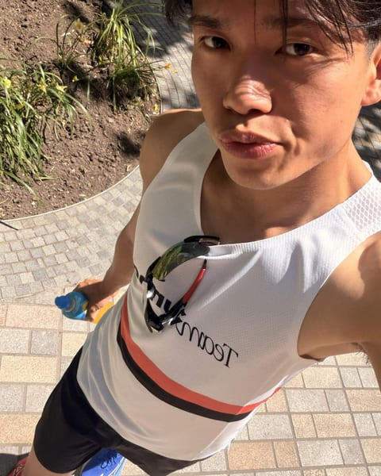

<p align="center">
  
</p>

<p align="center">
  <a href="https://damienta.pages.dev/"></a>
  <a href="https://www.linkedin.com/in/damien-ta"></a>
  <a href="mailto:tadamien8@gmail.com"></a>
</p>

## 🕹️ Player select

<table>
  <tr>
    <td width="240" valign="top">
      
    </td>
    <td valign="top">

```txt
PLAYER     Damien Ta
CLASS      Platform / DevOps Engineer
GUILD      Fidelity, Data Platform team
TRAINED    BSc Computer Science, Southampton (First)
SIDE GAME  Running, logged on a Garmin
PERK       If I do it twice, I automate it
```

I like building things that help me. If I want to know how I slept, what I've had on repeat or whether those headphones finally dropped in price, I'd rather build the tool than check five apps. Most of my side projects start that way, and they're where I try out tech I don't get to use at work.

</td>
  </tr>
</table>

## 🗺️ Current quest

At work I look after Denodo, Oracle Analytics and Power BI at Fidelity, and I'm moving on-prem databases into Oracle Cloud. Outside work I'm turning **spotify-stats** into a proper data platform, one stage at a time: the serverless ingestion on AWS is done, Airflow, dbt and an Iceberg lakehouse are next.

## 📜 Quest log

<table>
  <tr>
    <td width="50%" valign="top">
      <h3><a href="https://github.com/damienta/spotify-stats">🎧 Spotify Stats</a></h3>
      <sub><code>IN PROGRESS</code></sub>
      <p>A stats.fm-style listening tracker I'm growing into a small data platform. A Lambda polls Spotify every 20 minutes, DuckDB crunches the stats and FastAPI serves them.</p>
      <sub>Python · AWS Lambda · DynamoDB · DuckDB · Terraform</sub>
    </td>
    <td width="50%" valign="top">
      <h3><a href="https://github.com/damienta/garmin-health-monitor">⌚ Garmin Health Monitor</a></h3>
      <sub><code>LIVE · RUNS EVERY MORNING</code></sub>
      <p>My own sleep and recovery dashboard. Every morning it pulls last night from my watch, flags a green, amber or red recovery light and drops a summary in Discord. Runs on free plans.</p>
      <sub>Python · React · Cloudflare Workers · D1 · GitHub Actions</sub>
    </td>
  </tr>
  <tr>
    <td width="50%" valign="top">
      <h3><a href="https://damienta.pages.dev/">📖 Portfolio, the Wikipedia edition</a></h3>
      <sub><code>LIVE</code></sub>
      <p>My portfolio, written as a Wikipedia article about me. Infobox, contents sidebar, citations, light and dark mode, even a "last edited" footer.</p>
      <sub>React · TypeScript · Vite · Cloudflare Pages</sub>
    </td>
    <td width="50%" valign="top">
      <h3><a href="https://github.com/damienta/price-checker">🏷️ Price Checker</a></h3>
      <sub><code>LIVE · 8AM DAILY</code></sub>
      <p>Tell it what I want and a price to beat. Every morning it checks UK shops, PriceSpy, PriceRunner and HotUKDeals, then posts the best deal to Discord. No server, no database.</p>
      <sub>Python · GitHub Actions · Discord</sub>
    </td>
  </tr>
  <tr>
    <td width="50%" valign="top">
      <h3><a href="https://github.com/damienta/internship-tracker">🎯 Tracker.dev</a></h3>
      <sub><code>COMPLETE · DISSERTATION</code></sub>
      <p>A full-stack internship tracker with scrapers that pull in graduate and internship roles, plus application tracking and community threads.</p>
      <sub>React · Flask · PostgreSQL · Pytest</sub>
    </td>
    <td width="50%" valign="top">
      <h3>⚔️ Boss fights (hackathons)</h3>
      <p><b>Blue Sentry</b>, HackSussex 2025 winner. Real-time misinformation detection on Bluesky with BERT and Gemini.</p>
      <p><b>Runna Weekly Recap</b>, internal hackathon. Weekly running summaries driven by EventBridge, SQS and Lambda.</p>
    </td>
  </tr>
</table>

## 🏆 Achievements

<p align="center">
  
</p>

## 🎒 Inventory

<p align="center">
  <br/>
  
</p>

## 📈 Save file

<p align="center">
  
</p>

<p align="center">
  <sub>Game saved. Say hi on <a href="https://www.linkedin.com/in/damien-ta">LinkedIn</a> if you want to talk cloud, pipelines or running.</sub>
</p>
